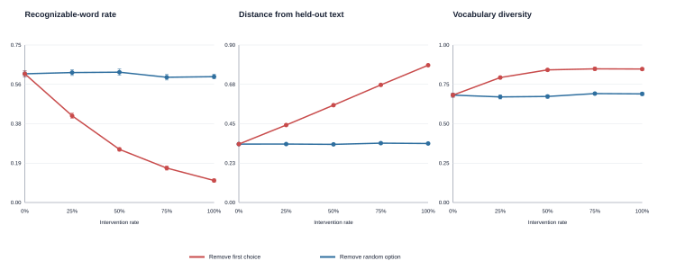

# Next Character Suppression Nano Capstone

## Research question

What happens when a text-generating model is repeatedly prevented from choosing
the character it considers most likely to come next?

This Nano Capstone trains a character-level language model on public-domain
English text. During generation, the experiment removes the model's most
probable next character at controlled rates from 0% to 100%. A matched control
removes a random candidate instead. The comparison tests whether the observed
changes come specifically from denying the model its first choice rather than
from merely reducing its options.

The completed study compares recognizable-word frequency, vocabulary diversity,
repetition, character entropy, statistical distance from held-out English, and
word rank-frequency structure across 200 generated samples.

## Completed study

- Selected and froze Jane Austen's *Pride and Prejudice*, Project Gutenberg
  ebook 1342, as the corpus.
- Created a contiguous 90/10 split with 647,044 training characters and 71,894
  held-out characters.
- Compared character n-gram orders 3, 4, and 5 on held-out text.
- Selected order 5 because it produced the lowest held-out cross-entropy:
  1.954 bits per character.
- Implemented most-probable-character suppression and the matched random-removal
  control at five intervention rates.
- Added deterministic seeds, auditable outputs, six metric families, and 28
  automated tests.
- Completed the frozen full experiment: 5 rates × 2 conditions × 20 seeds, with
  all 200 expected samples generated successfully.
- Found a clear dose-response pattern under first-choice suppression, while the
  matched random-removal control remained nearly flat.
- Found that full first-choice suppression reduced recognizable-word frequency
  from 0.613 to 0.105 and increased statistical distance from held-out text from
  0.334 to 0.784.
- Found that diversity increased while recognizable words collapsed, showing
  that more varied output did not mean better language.
- Found no support for the predicted increase in repetition; repeated
  four-character sequences instead became less common.

The main limitation is that the baseline model already produces noisy, only
partly recognizable English. The findings therefore describe this corpus,
model, and intervention rather than modern language models generally.



## Presentation materials

- [Seven-slide video deck](deliverables/Nano_Capstone_Video_Deck.pptx)
- [Four-to-five-minute narration script](deliverables/Nano_Capstone_Video_Script.md)
- [Full findings summary](evidence/final_run_2026-11-17/FINDINGS.md)

## Repository structure

- `nano_capstone/corpus.py`: corpus cleaning, normalization, splitting, and
  checksums.
- `nano_capstone/ngram.py`: smoothed character n-gram model with backoff.
- `nano_capstone/calibrate.py`: model-order comparison on held-out text.
- `nano_capstone/experiment.py`: suppression and control experiment runner.
- `nano_capstone/metrics.py`: predefined text measurements.
- `nano_capstone/pipeline.py`: one-command end-to-end pipeline.
- `nano_capstone/tests/`: automated tests.
- `evidence/`: the frozen corpus manifest and calibration results, without the
  copyrighted/downloaded text files themselves.
- `evidence/final_run_2026-11-17/`: condition statistics, paired comparisons,
  the findings summary, run manifest, and the main results figure.
- `nano_capstone/analyze.py`: reproducible analysis and figure generation for a
  completed pipeline run.
- `PROCESS_LOG.md`: decisions, validation, AI use, and remaining work.

## Run the demonstration

The project uses only the Python standard library.

```bash
python3 -m nano_capstone.pipeline \
  nano_capstone/data/demo_source.txt \
  /tmp/nano_capstone_demo \
  --sample-length 200 \
  --seed-count 3
```

Run all tests:

```bash
python3 -m unittest discover -s nano_capstone/tests -t . -v
```

## Reproduce the corpus preparation

Download the official Project Gutenberg text:

```bash
curl -L https://www.gutenberg.org/cache/epub/1342/pg1342.txt \
  -o nano_capstone/data/pride_and_prejudice_pg1342.txt
```

Then prepare and freeze it:

```bash
python3 -m nano_capstone.corpus \
  nano_capstone/data/pride_and_prejudice_pg1342.txt \
  artifacts/corpus
```

The expected source checksum and all processed-file checksums are recorded in
`evidence/corpus_manifest.json`.

## Run the final experiment

The frozen full run was completed on 17 November 2026. To reproduce it in a new
output directory:

```bash
python3 -m nano_capstone.pipeline \
  nano_capstone/data/pride_and_prejudice_pg1342.txt \
  outputs/final_run
```

The pipeline refuses to overwrite or mix results from an earlier run.

Summarize a completed run and regenerate the evidence files:

```bash
python3 -m nano_capstone.analyze \
  outputs/final_run \
  evidence/final_run
```

